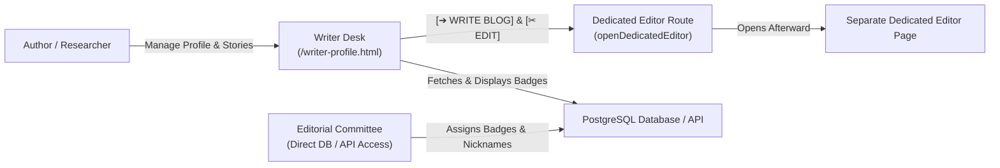

# ACES Broadsheet Gazette Platform — Project Summary

> **The Official Academic Technical Chronicle & Editorial Publishing Platform**  
> *Department of Computer Engineering · ACES PVGCOET*  
> Devoted to Systems Architecture, Consensus, Compiler Truths & Peer Accreditation.

---

## 1. Executive Overview

The **ACES Broadsheet Gazette** (`blog_front_prof_pg`) is a focused academic publishing platform and creator workbench designed for engineering students, faculty, and technical researchers. Built on **Next.js 16 (App Router + Turbopack)**, **TypeScript**, and **Prisma ORM (PostgreSQL)**, the application enforces an authentic, high-contrast **"Old-Money Academic Broadsheet"** aesthetic across both Light and Dark proofs.

### Clean Ecosystem Structure
1. **Writer Workbench (`/writer-profile.html`)**: Authors manage their published technical dispatches, track readership performance, edit fellow credentials, and trigger the dedicated editor.
2. **Dedicated Editor Integration Hook**: The workbench maintains active integration hooks (`[ ➔ WRITE BLOG ]` and `[ ✂ EDIT ]`), structured via `EDITOR_CONFIG` to seamlessly open a separate dedicated editor page that will be added afterward.
3. **Editorial Team Database Accreditation**: Editorial board controls are not exposed on the public frontend; instead, designated editorial team members receive direct database access to grant official accolades and nicknames, which appear directly on the author's fellow pass.



---

## 2. Design System & Broadsheet Philosophy

The visual identity is modeled after classical 20th-century academic broadsheets and letterpress printing:

* **Stark Contrast & Pure Palette**: High-contrast pure black (`#000000`) and pure paper white (`#ffffff`). No arbitrary gradients, pastel shadows, or rounded corners.
* **Zero-Radius Strict Rule**: All elements enforce `border-radius: 0 !important`, creating razor-sharp coupon cut-outs, double-line rules, and ticket borders.
* **Classical Broadsheet Typography**:
  * **Headings**: `Anton` (Uppercase, impactful condensed display sans).
  * **Body Copy**: `Merriweather` / `PT Serif` (Editorial serif with high legibility).
  * **Metadata & Badges**: `Courier Prime` / Monospace (Typewriter registration labels).
* **Dual-Proof Ink Switcher**:
  * Toggles instantly between **Light Mode** (Crisp Paper Proof) and **Dark Mode** (Inverted Letterpress Proof).
  * Button label toggles strictly between **`✦ DARK`** and **`✦ LIGHT`**.
  * Synchronized globally across all views via `localStorage.aces_theme`.

---

## 3. Core Modules & User Interfaces

### 3.1. Writer Profile Workbench (`/writer-profile.html`)
The comprehensive personal command center for authors and technical fellows:
* **Academic Press Pass (Fellow Card)**:
  * Halftone author portrait with camera registration marks (`⊕ ✛`).
  * Verified Fellow badge and handle (`@aarav_writes`).
  * Author signature and biographic beat.
  * **Accreditation Cluster (`#authorBadgesCluster`)**: Renders official accolades and nicknames awarded by the editorial team (e.g. `★ TOP CONTRIBUTOR '25`, `⚡ SYSTEMS LEAD`).
  * Direct action **`[ ✎ EDIT PROFILE ]`** to open the credentials popup.
* **User Credentials Modal**:
  * Encapsulated popup dialog (`.snappy-modal-overlay`) completely hidden by default.
  * Allows updating Full Name, Handle Slug, Photo URL (with preview), and Bio.
  * Persists to `localStorage.aces_user_profile` and syncs with `PUT /api/profile/:id`.
* **Dispatches & Story Stream**:
  * Tabular broadsheet stories ledger with full-bleed media thumbnails (`object-fit: cover`).
  * Metadata tags for reading time, word count, category, and publication dates.
  * Row actions: **`[ ✂ EDIT ]`** (triggers `openDedicatedEditor(null, story.id)`) and **`[ ☛ PREVIEW ]`** (manuscript proof).
* **Top Navigation Bar**:
  * Quick live search (`/` shortcut).
  * **`[ ✦ DARK / LIGHT ]`**: Instant theme switcher.
  * **`[ ➔ WRITE BLOG ]`**: Triggers `openDedicatedEditor(event)`.

### 3.2. Dedicated Editor Integration Architecture
The codebase is structured to cleanly accept the separate dedicated editor page added afterward:
* **Configuration Point**:
  ```javascript
  const EDITOR_CONFIG = {
    editorRoute: "/editor", // Target path for dedicated editor
  };

  function openDedicatedEditor(e, blogId) {
    if (e && e.preventDefault) e.preventDefault();
    const targetUrl = blogId
      ? EDITOR_CONFIG.editorRoute + "?id=" + encodeURIComponent(blogId)
      : EDITOR_CONFIG.editorRoute;
    window.location.href = targetUrl;
  }
  ```
* Clicking either **`[ ➔ WRITE BLOG ]`** in the topbar or **`[ ✂ EDIT ]`** in any story row routes directly to the dedicated editor with optional manuscript ID parameter.

### 3.3. Editorial Accreditation & Database Architecture
* Editorial administration is intentionally uncoupled from the author's frontend.
* The Prisma `Badge` data model and `/api/profile/[id]/badges` REST endpoints remain active.
* When a designated team member updates the database or issues badges/nicknames, they automatically appear in the author's `#authorBadgesCluster`.

---

## 4. Technical Architecture & File Directory

```
d:/blog_front_prof_pg
├── connections.md                        # Complete Architecture & Flowchart Map
├── PROJECT_SUMMARY.md                    # Comprehensive Project Documentation
├── app/
│   ├── api/
│   │   ├── health/route.ts               # Healthcheck heartbeat
│   │   ├── profile/[id]/route.ts         # Author profile GET & PUT
│   │   ├── profile/[id]/badges/route.ts  # Badges GET, POST, DELETE
│   │   └── ranking/route.ts              # Campus ranking route
│   ├── profile/[id]/page.tsx             # Public profile route (redirects to desk)
│   ├── layout.tsx & globals.css          # Core layout & styling resets
│   ├── not-found.tsx                     # Broadsheet 404 page
│   └── page.tsx                          # Root landing page (redirects to desk)
├── lib/
│   ├── mock-data.ts                      # Offline/fallback mock data
│   ├── prisma.ts                         # Prisma client singleton
│   ├── profile-service.ts                # Resilient data retrieval service
│   └── types.ts                          # TypeScript types & interfaces
├── prisma/
│   ├── schema.prisma                     # PostgreSQL data models (User, Badge, Team)
│   └── seed.ts                           # Database seeding script
├── public/
│   ├── writer-profile.html               # Writer Profile Desk & Workbench
│   └── images/                           # Avatars & placeholder assets
├── next.config.ts, tsconfig.json, etc.   # Next.js & TypeScript configs
└── package.json
```

---

## 5. Summary of All Active API Endpoints

| Method | Endpoint | Description | Payload | Status |
| :--- | :--- | :--- | :--- | :--- |
| **`GET`** | `/api/profile/:id` | Retrieve author profile & badges | None | `200 OK` |
| **`PUT`** | `/api/profile/:id` | Update author credentials (Name, Avatar, Bio) | `{ name, profileImg, username, bio }` | `200 OK` |
| **`GET`** | `/api/profile/:id/badges` | List accredited accolades for an author | None | `200 OK` |
| **`POST`** | `/api/profile/:id/badges` | Accredit new editorial badge/nickname to author | `{ name, emoji, awardedBy, style }` | `201 Created` |
| **`DELETE`** | `/api/profile/:id/badges` | Revoke an accredited badge | Query `?badgeId=...` | `200 OK` |
| **`GET`** | `/api/ranking` | Fetch campus leaderboard teams & rankings | None | `200 OK` |
| **`GET`** | `/api/health` | Server heartbeat & healthcheck | None | `200 OK` |
