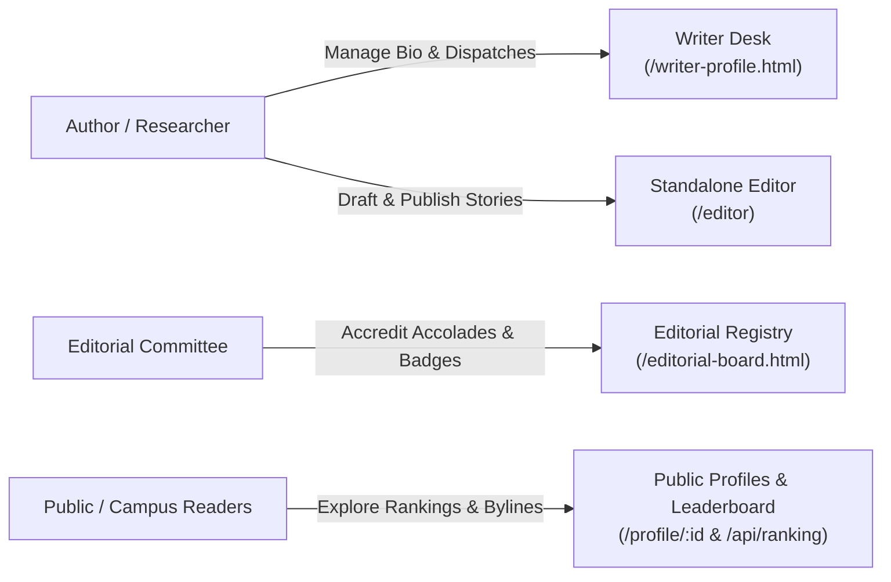

# ACES Broadsheet Gazette & Editorial Platform — Project Summary

> **The Official Academic Technical Chronicle & Editorial Publishing Platform**  
> *Department of Computer Engineering · ACES PVGCOET*  
> Devoted to Systems Architecture, Consensus, Compiler Truths & Peer Accreditation.

---

## 1. Executive Overview

The **ACES Broadsheet Gazette** (`blog_front_prof_pg`) is a full-stack academic publishing platform and creator workbench designed for engineering students, faculty, and technical researchers. Built on **Next.js 16 (App Router + Turbopack)**, **TypeScript**, and **Prisma ORM (PostgreSQL)**, the application rejects generic modern SaaS design in favor of a timeless, high-contrast **"Old-Money Academic Broadsheet"** broadsheet aesthetic.

The platform provides an end-to-end editorial ecosystem:
1. **Writers** can manage their technical dispatches, track readership performance, edit user credentials, and compose articles in a dedicated manuscript editor.
2. **The Editorial Board & Faculty Committee** possess an independent accreditation registry to grant peer-reviewed honours and institutional awards.
3. **Readers** can explore verified technical dispatches, view fellow credential passes, and follow campus team rankings.



---

## 2. Design System & Broadsheet Philosophy

The visual identity is modeled after classical 20th-century academic broadsheets and letterpress printing:

* **Stark Contrast & Pure Palette**: High-contrast pure black (`#000000`) and pure paper white (`#ffffff`). No arbitrary gradients, pastel shadows, or rounded corners.
* **Zero-Radius Strict Rule**: All elements enforce `border-radius: 0 !important`, creating razor-sharp coupon cut-outs, double-line rules, and ticket borders.
* **Classical Broadsheet Typography**:
  * **Headings**: `Anton` (Uppercase, impactful condensed display sans).
  * **Body Copy**: `Merriweather` / `PT Serif` (Editorial serif with high legibility).
  * **Metadata & Badges**: `Courier Prime` / Monospace (Typewriter registration labels).
* **Authentic Print Details**:
  * Registration marks (`⊕ ✛`) on portrait stamps.
  * Perforated coupon borders (`border: 2px dashed #000`).
  * Scissor cut-out action labels (`[ ✂ EDIT ]`, `[ ✂ SAVE DRAFT ]`, `[ ✂ REVOKE ]`).
  * Official seals (`★ OFFICIAL WRITER DESK`, `⚖ EDITORIAL DESK`).
* **Dual-Proof Ink Switcher**:
  * Toggles instantly between **Light Mode** (Crisp Paper Proof) and **Dark Mode** (Inverted Letterpress Proof).
  * Button label toggles strictly between **`✦ DARK`** and **`✦ LIGHT`**.
  * Synchronized globally across all desks via `localStorage.aces_theme`.

---

## 3. Core Modules & User Interfaces

### 3.1. Writer Profile Workbench (`/writer-profile.html`)
The comprehensive personal command center for authors and technical fellows:
* **Academic Press Pass (Fellow Card)**:
  * Halftone/stamped author portrait with camera registration marks.
  * Verified Fellow badge and handle (`@aarav_writes`).
  * Live biographic beat and systems specialty statement.
  * Official accreditation cluster displaying peer-reviewed accolades.
  * Direct action **`[ ✎ EDIT PROFILE ]`** to open the credentials popup.
* **User Credentials Modal**:
  * Encapsulated popup dialog (`.snappy-modal-overlay`) completely hidden by default.
  * Allows updating Full Name, Handle Slug, Photo URL (with preview), and Bio.
  * Persists to `localStorage.aces_user_profile` and syncs with `PUT /api/profile/:id`.
* **Dispatches & Story Stream**:
  * Tabular broadsheet stories ledger with full-bleed media thumbnails (`object-fit: cover`).
  * Metadata tags for reading time, word count, category, and publication dates.
  * Row actions: **`[ ✂ EDIT ]`** (opens `/editor?id=...`) and **`[ 👁 READ ]`** (proofreader modal).
* **Top Navigation Bar**:
  * Quick live search (`/` shortcut).
  * Navigation links: **`[ ⚖ EDITORIAL DESK ]`**, **`[ ✦ DARK / LIGHT ]`**, and **`[ ➔ WRITE BLOG ]`**.

### 3.2. Dedicated Blog Editor (`/editor`)
A standalone manuscript writing canvas located at `/editor`:
* **Typeset Metadata Deck**: Inputs for Dispatch Title, Deck Subtitle, Category, Tags, and Cover Image URL.
* **Editorial Markdown Toolbar**: Quick inserters for bold (`**`), italic (`*`), monospace code blocks (` ``` `), blockquotes (`>`), bullet lists (`- `), and links.
* **Telemetry Bar**: Live character count, word count, and estimated read time.
* **Split Broadsheet Preview**: Real-time dual-pane proofing to preview live typography alongside markdown.
* **Publishing Controls**:
  * **`[ ✂ SAVE DRAFT ]`**: Saves article to local draft storage with optimistic feedback.
  * **`[ ➔ PUBLISH BLOG ]`**: Publishes dispatch, updates live story feeds, and redirects to desk.
  * **`[ ✦ DARK / LIGHT ]`**: Editor-specific theme toggle synced with global theme.
  * **`[ ➔ WRITER DESK ]`**: One-click navigation back to workbench.

### 3.3. Dedicated Editorial Board Desk (`/editorial-board.html` & `/editorial`)
A specialized administrative workbench for the ACES Faculty & Editorial Committee:
* **Role Separation**: Decoupled from author desks so normal writers cannot self-grant badges.
* **Accreditation Issuance Desk**:
  * Candidate author selection (`user-1`, `user-2`, etc.).
  * Accolade preset dropdown:
    * `★ TOP CONTRIBUTOR '25 (Peer Leader)`
    * `⚡ SYSTEMS LEAD (Kernel Specialist)`
    * `🏆 EDITORIAL CHOICE '25 (Flagship Dispatch)`
    * `🎖️ RESEARCH FELLOW (Faculty Commended)`
    * `CUSTOM (Type bespoke accolade...)`
  * Awarding Body branding (`ACES PVGCOET Editorial Board`).
  * Badge Ink Treatment: `Solid Black Frame` vs. `Crisp Paper Outline`.
  * Action: **`[ ★ ACCREDIT & AWARD BADGE ]`** calling `POST /api/profile/:id/badges`.
* **Active Accreditations Registry & Ledger**:
  * Real-time ledger displaying all active honors awarded to the selected author.
  * Includes official timestamps, badge ink previews, and **`[ ✂ REVOKE ]`** actions calling `DELETE /api/profile/:id/badges`.

### 3.4. Public Profile & Campus Leaderboard (`/profile/[id]` & `/api/ranking`)
* **Public Profile Pass**: Renders student fellow rank, hometown, companion, school, and accredited honors.
* **Campus Podium & Leaderboard**: Displays house rankings, points, and daily streak records.

---

## 4. Technical Architecture & Data Layer

```
┌─────────────────────────────────────────────────────────────┐
│                    Next.js 16 (App Router)                  │
├───────────────────────────────┬─────────────────────────────┤
│      Frontend Pages           │      Server API Routes      │
│  - /writer-profile.html       │  - GET, PUT /api/profile/:id│
│  - /editorial-board.html      │  - GET, POST, DELETE        │
│  - /editor (page.tsx)         │    /api/profile/:id/badges  │
│  - /editorial (page.tsx)      │  - GET /api/ranking         │
│  - /profile/[id] (page.tsx)   │  - GET /api/health          │
├───────────────────────────────┴─────────────────────────────┤
│                    Profile Service Layer                    │
│     (Dual-layer resilience: Prisma DB + Mock Store Fallback) │
├───────────────────────────────┬─────────────────────────────┤
│         Prisma ORM            │     Browser Persistence     │
│   PostgreSQL Database         │  - localStorage.aces_theme  │
│   (Users, Badges, Teams)      │  - localStorage.aces_profile│
│                               │  - localStorage.aces_badges │
└───────────────────────────────┴─────────────────────────────┘
```

### 4.1. Prisma Schema (`prisma/schema.prisma`)
The PostgreSQL schema defines three primary models:
* **`User`**: Author identity (`id`, `name`, `email`, `school`, `city`, `companion`, `rankTitle`, `avatarUrl`, `bannerUrl`, `badges[]`).
* **`Badge`**: Editorial honors (`id`, `name`, `iconUrl`, `earnedAt`, `userId` foreign key with cascade deletion).
* **`Team`**: Campus leaderboard groups (`id`, `name`, `points`, `streakDays`, `rank`, `emblemVariant`).

### 4.2. Dual-Layer Fault Tolerance
If the PostgreSQL instance is offline during local evaluation or front-end review:
* `lib/profile-service.ts` catches connection timeouts gracefully.
* Automatically falls back to in-memory mock data and browser `localStorage`.
* Prevents 500 crashes and enables 100% offline development.

---

## 5. Summary of All API Endpoints

| Method | Endpoint | Description | Payload | Status |
| :--- | :--- | :--- | :--- | :--- |
| **`GET`** | `/api/profile/:id` | Retrieve author profile & badges | None | `200 OK` |
| **`PUT`** | `/api/profile/:id` | Update author credentials (Name, Avatar, Bio) | `{ name, profileImg, username, bio }` | `200 OK` |
| **`GET`** | `/api/profile/:id/badges` | List accredited accolades for an author | None | `200 OK` |
| **`POST`** | `/api/profile/:id/badges` | Accredit new editorial badge to author | `{ name, emoji, awardedBy, style }` | `201 Created` |
| **`DELETE`** | `/api/profile/:id/badges` | Revoke an accredited badge | Query `?badgeId=...` | `200 OK` |
| **`GET`** | `/api/ranking` | Fetch campus leaderboard teams & rankings | None | `200 OK` |
| **`GET`** | `/api/health` | Server heartbeat & healthcheck | None | `200 OK` |

---

## 6. Key Refinements Completed

During recent iterations, the platform was refined based on user directives:
1. **Old-Money Broadsheet Preserved**: Maintained authentic broadsheet aesthetics, high-contrast borders, and Merriweather/Anton typography.
2. **Theme Switcher Simplified**: Theme toggle text changed from stylized phrases to clean **`✦ DARK`** (in light mode) and **`✦ LIGHT`** (in dark mode).
3. **Clutter Removed**:
   - Removed obsolete header banner (`THE CAMPUS BROADSHEET`).
   - Removed `PRINT GAZETTE` button.
   - Removed `READERSHIP VOLUME BY PUBLICATION` step chart.
   - Removed `ASSIGN FACULTY PEER REVIEWER` dropdown from author view.
4. **Thumbnail Fill**: All story thumbnail covers set to `object-fit: cover; width: 100%; height: 100%` to fill media blocks without blank padding.
5. **Modal Bug Resolved**: Fixed unstyled modal divs (`.snappy-modal-backdrop` → `.snappy-modal-overlay`), keeping author credential settings completely hidden until `[ ✎ EDIT PROFILE ]` is clicked.
6. **Editorial Role Separation**: Moved administrative accolade issuance from the author desk into its own dedicated page (`/editorial-board.html` & `/editorial`).
7. **Stand-Alone Editor Connected**: Connected `➔ WRITE BLOG` and `[ ✂ EDIT ]` directly to the `/editor` suite.
8. **Comprehensive Connections Map**: Architecture flowcharts and API contracts fully documented in `connections.md`.

---

## 7. Project File Directory Guide

```
d:\blog_front_prof_pg\
├── app\
│   ├── api\
│   │   ├── health\route.ts                # Heartbeat endpoint
│   │   ├── profile\[id]\route.ts          # Profile GET & PUT
│   │   ├── profile\[id]\badges\route.ts   # Badges GET, POST, DELETE
│   │   └── ranking\route.ts               # Campus leaderboard
│   ├── editor\page.tsx                    # Standalone Blog Editor UI
│   ├── editorial\page.tsx                 # Dedicated Editorial Board Route
│   ├── profile\[id]\page.tsx              # Public Fellow Profile View
│   ├── layout.tsx & globals.css           # Global shell & broadsheet resets
│   └── page.tsx                           # Root landing page
├── components\                            # Reusable React UI widgets
├── lib\
│   ├── format.ts                          # Number & date formatting utilities
│   ├── mock-data.ts                       # Broadsheet seed and mock store
│   ├── prisma.ts                          # Prisma database client singleton
│   ├── profile-service.ts                 # Resilient data retrieval service
│   └── types.ts                           # Full TypeScript interfaces
├── prisma\
│   ├── schema.prisma                      # PostgreSQL data model definitions
│   └── seed.ts                            # Database seeding script
├── public\
│   ├── writer-profile.html                # Writer Profile workbench (Static)
│   ├── editorial-board.html               # Editorial Board Desk (Static)
│   └── images\                            # Avatars & placeholders
├── connections.md                         # Mermaid architecture diagrams
├── writer-profile.html                    # Root mirror of writer desk
├── editorial-board.html                   # Root mirror of editorial desk
└── package.json                           # Dependencies & Next.js config
```
