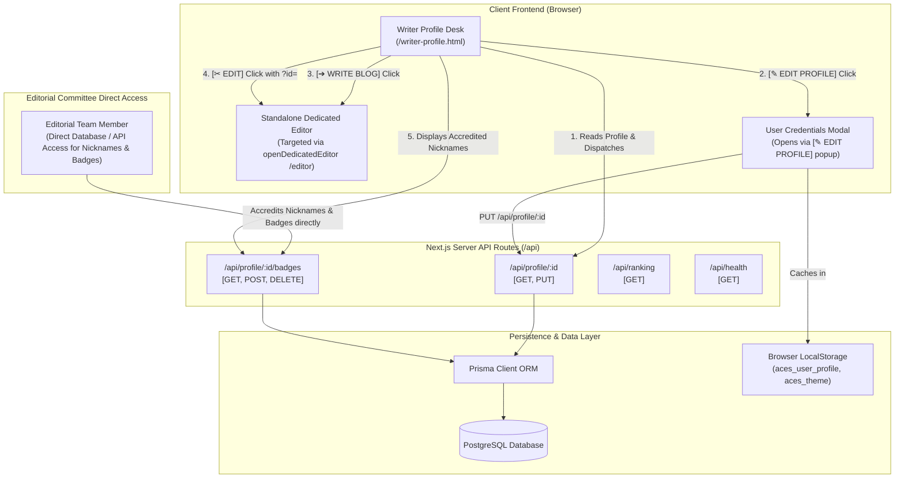
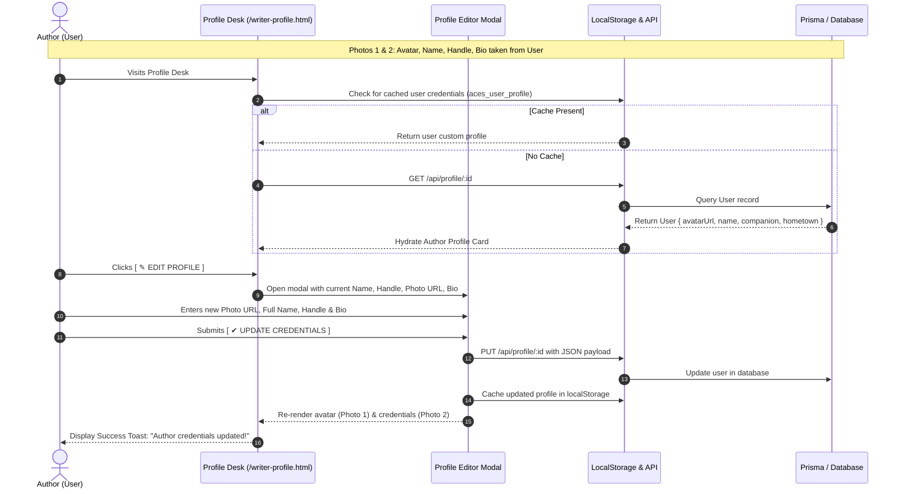
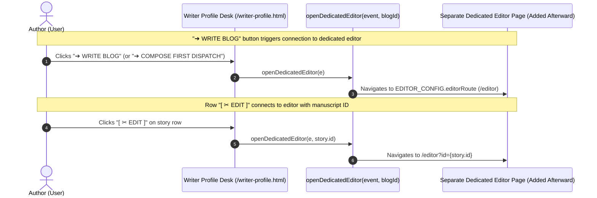
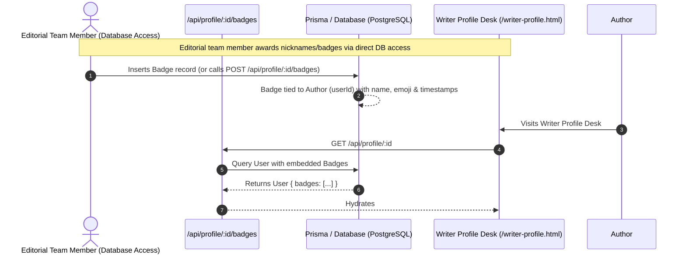

# ACES Gazette — Architecture & API Connections Map

This document outlines the complete architectural topology, component connections, data flows, and endpoint specifications for the **ACES Broadsheet Gazette** writer profile workbench and blog publishing engine.

---

## 1. System Overview & Component Topology



---

## 2. User Profile Connection Flow (Photos 1 & 2)



---

## 3. Dedicated Blog Editor Connection Architecture

The workbench maintains active integration hooks (`[ ➔ WRITE BLOG ]` and `[ ✂ EDIT ]`) structured to seamlessly open the separate dedicated editor page added afterward.



---

## 4. Editorial Team Database & Nickname Accreditation Architecture

The public website does not expose editorial administrative controls. Instead, designated members of the ACES Editorial Committee manage official accolades, nicknames, and recognition labels directly via database access or backend credentials.



---

## 5. Complete API Endpoints Specification

| HTTP Method | Route | Description | Auth / Role | Request Payload | Response Shape |
| :--- | :--- | :--- | :--- | :--- | :--- |
| **`GET`** | `/api/profile/:id` | Fetch author profile with embedded badges | Public | None | `User` object (name, avatarUrl, bio, email, badges[]) |
| **`PUT`** | `/api/profile/:id` | Update author credentials (Photo 1 & 2) | Author / Self | `{ name, profileImg, username, bio }` | `200 OK` with updated `User` object |
| **`GET`** | `/api/profile/:id/badges` | List accredited badges for an author | Public | None | `Badge[]` array |
| **`POST`** | `/api/profile/:id/badges` | Accredit official editorial label (Photo 5) | Editorial Team | `{ name, emoji, awardedBy, style }` | `201 Created` `{ success: true, badge: { ... } }` |
| **`DELETE`** | `/api/profile/:id/badges` | Revoke an editorial label | Editorial Team | `{ badgeId: string }` | `200 OK` `{ success: true }` |
| **`GET`** | `/api/ranking` | Fetch campus team leaderboard & rankings | Public | None | `Team[]` array |
| **`GET`** | `/api/health` | Healthcheck and server status | Public | None | `{ status: "ok", timestamp }` |

---

## 6. Frontend Navigation & Action Triggers

| UI Trigger Button | Target / Action | User Role | Description |
| :--- | :--- | :--- | :--- |
| **`➔ WRITE BLOG`** (Topbar) | `openDedicatedEditor(e)` | Author | Navigates to `/editor` (Dedicated editor page added afterward) |
| **`➔ WRITE BLOG`** (Workbench) | `openDedicatedEditor(e)` | Author | Navigates to `/editor` from dispatches toolbar |
| **`[ ✂ EDIT ]`** (Row Action) | `openDedicatedEditor(e, id)` | Author | Opens dedicated editor with article ID parameter |
| **`[ ✎ EDIT PROFILE ]`** | Opens `#profileModalOverlay` | Author | Allows author to update avatar photo, name, handle, and bio |
| **`[ ☛ PREVIEW ]`** | Opens `#readerModalOverlay` | Any / Reader | In-modal technical manuscript preview proof |

---

## 7. Data Models & Type Contracts

### `User` Contract
```typescript
interface User {
  id: string;
  name: string;
  username: string;
  role: "WRITER" | "EDITOR" | "ADMIN";
  avatarUrl: string | null;  // Photo 1: User-uploaded portrait
  bio: string;               // Photo 2: Author biography & beat
  labels: EditorialLabel[];  // Photo 5: Editorial accolades
  createdAt: string;
  updatedAt: string;
}
```

### `EditorialLabel` Contract
```typescript
interface EditorialLabel {
  key: string;
  text: string;              // e.g. "TOP CONTRIBUTOR '25", "SYSTEMS LEAD"
  emoji: string;             // e.g. "★", "⚡", "🏆"
  awarded: boolean;          // true = Solid Black Frame, false = Outline
  awardedBy: string;         // e.g. "ACES PVGCOET Editorial Board"
  awardedAt: string;         // ISO Timestamp
}
```

### `Blog` Contract
```typescript
interface Blog {
  id: string;
  slug: string;
  title: string;
  thumbnail: string;
  author: string;
  status: "DRAFT" | "PUBLISHED" | "UNDER_REVIEW" | "REVISION_DRAFT" | "ARCHIVED" | "REJECT";
  category: string;
  tags: string[];
  readTime: string;
  content: string;
  excerpt: string;
  latestRevisionVersion: number;
  latestPublishedVersion: number;
  createdAt: string;
  modifiedAt: string;
}
```

