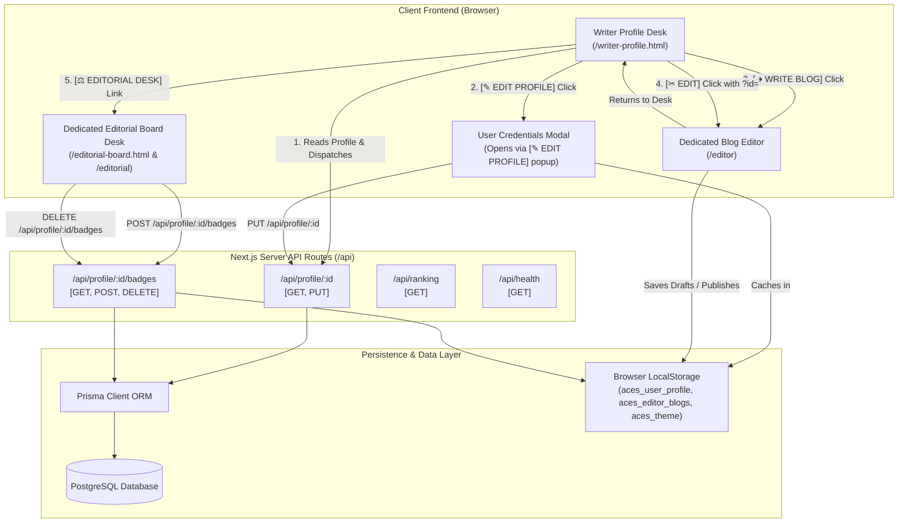
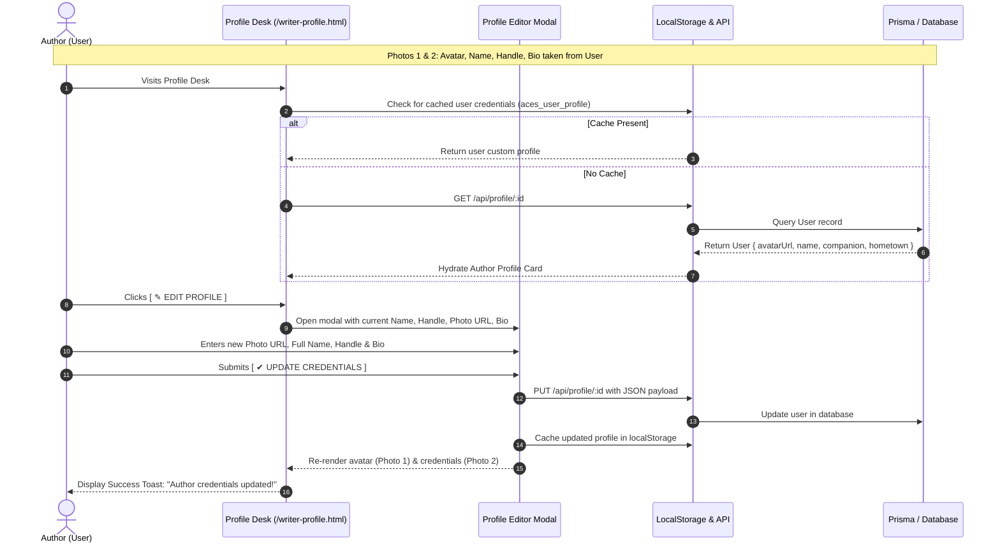
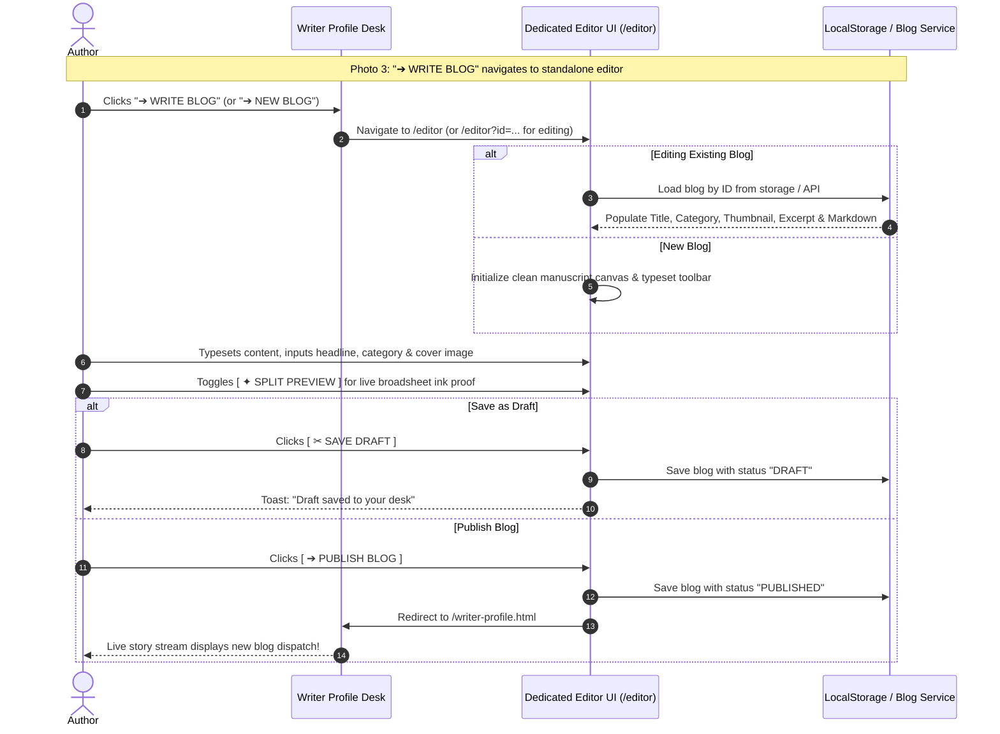
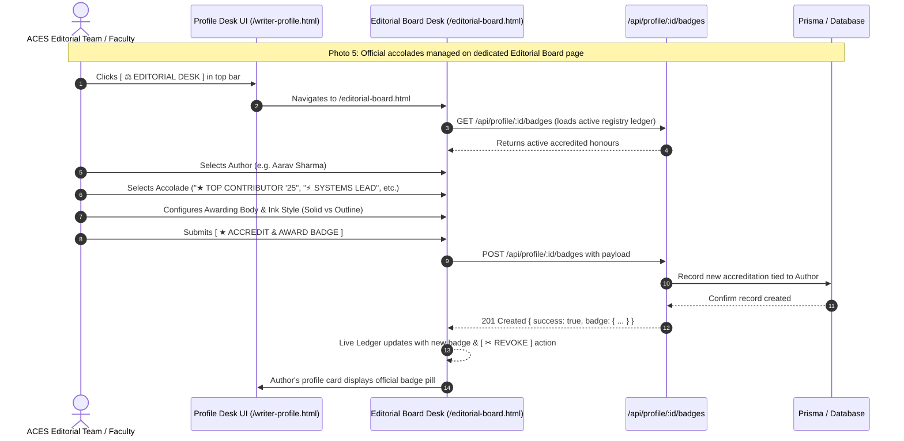

# ACES Gazette — Architecture & API Connections Map

This document outlines the complete architectural topology, component connections, data flows, and endpoint specifications for the **ACES Broadsheet Gazette** writer profile workbench and blog publishing engine.

---

## 1. System Overview & Component Topology



---

## 2. User Profile Connection Flow (Photos 1 & 2)



---

## 3. Dedicated Blog Editor Connection Flow (Photo 3)



---

## 4. Dedicated Editorial Board Accreditation Desk (/editorial-board.html)



---

## 5. Complete API Endpoints Specification

| HTTP Method | Route | Description | Auth / Role | Request Payload | Response Shape |
| :--- | :--- | :--- | :--- | :--- | :--- |
| **`GET`** | `/api/profile/:id` | Fetch author profile with embedded badges | Public | None | `User` object (name, avatarUrl, bio, email, badges[]) |
| **`PUT`** | `/api/profile/:id` | Update author credentials (Photo 1 & 2) | Author / Self | `{ name, profileImg, username, bio }` | `200 OK` with updated `User` object |
| **`GET`** | `/api/profile/:id/badges` | List accredited badges for an author | Public | None | `Badge[]` array |
| **`POST`** | `/api/profile/:id/badges` | Accredit official editorial label (Photo 5) | Editorial Team | `{ name, emoji, awardedBy, style }` | `201 Created` `{ success: true, badge: { ... } }` |
| **`DELETE`** | `/api/profile/:id/badges` | Revoke an editorial label | Editorial Team | `{ badgeId: string }` | `200 OK` `{ success: true }` |
| **`GET`** | `/api/ranking` | Fetch campus team leaderboard & rankings | Public | None | `Team[]` array |
| **`GET`** | `/api/health` | Healthcheck and server status | Public | None | `{ status: "ok", timestamp }` |

---

## 6. Frontend Navigation & Action Triggers

| UI Trigger Button | Target / Action | User Role | Description |
| :--- | :--- | :--- | :--- |
| **`➔ WRITE BLOG`** (Topbar) | Navigate to `/editor` | Author | Opens dedicated full-page blog composer (Photo 3) |
| **`➔ WRITE BLOG`** (Workbench) | Navigate to `/editor` | Author | Opens dedicated blog composer from workbench |
| **`[ ✂ EDIT ]`** (Row Action) | Navigate to `/editor?id={blogId}` | Author | Opens existing article for manuscript revision |
| **`[ ✎ EDIT PROFILE ]`** | Opens `#profileModalOverlay` | Author | Allows author to update avatar photo, name, and bio (Photo 1 & 2) |
| **`[ ★ EDITORIAL: AWARD LABEL ]`** | Opens `#editorialBadgeModalOverlay` | Editorial Team | Allows editorial board to accredit official accolades (Photo 5) |
| **`[ ☛ PREVIEW ]`** | Opens `#readerModalOverlay` | Any / Reader | In-modal technical manuscript preview |

---

## 7. Data Models & Type Contracts

### `User` Contract
```typescript
interface User {
  id: string;
  name: string;
  username: string;
  role: "WRITER" | "EDITOR" | "ADMIN";
  avatarUrl: string | null;  // Photo 1: User-uploaded portrait
  bio: string;               // Photo 2: Author biography & beat
  labels: EditorialLabel[];  // Photo 5: Editorial accolades
  createdAt: string;
  updatedAt: string;
}
```

### `EditorialLabel` Contract
```typescript
interface EditorialLabel {
  key: string;
  text: string;              // e.g. "TOP CONTRIBUTOR '25", "SYSTEMS LEAD"
  emoji: string;             // e.g. "★", "⚡", "🏆"
  awarded: boolean;          // true = Solid Black Frame, false = Outline
  awardedBy: string;         // e.g. "ACES PVGCOET Editorial Board"
  awardedAt: string;         // ISO Timestamp
}
```

### `Blog` Contract
```typescript
interface Blog {
  id: string;
  slug: string;
  title: string;
  thumbnail: string;
  author: string;
  status: "DRAFT" | "PUBLISHED" | "UNDER_REVIEW" | "REVISION_DRAFT" | "ARCHIVED" | "REJECT";
  category: string;
  tags: string[];
  readTime: string;
  content: string;
  excerpt: string;
  latestRevisionVersion: number;
  latestPublishedVersion: number;
  createdAt: string;
  modifiedAt: string;
}
```

